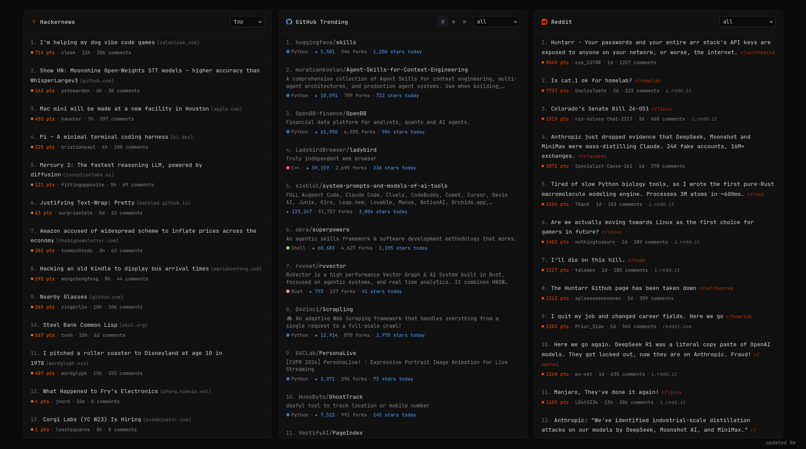

# tty1

A fast, minimal dashboard that aggregates trending content from Hacker News, GitHub, and Reddit into a single page. Built in Rust with server-rendered HTML and no JavaScript framework. No tracking, no analytics, minimal vanilla JS with no build step, and full offline support — works as your browser homepage without any extension. Everything is served as a single server-rendered HTML page (~166 KB compressed).



## Features

- **Hacker News** — Top, Newest, and Show HN stories (30 per page)
- **GitHub Trending** — Repos across 17 languages, filterable by daily/weekly/monthly
- **Reddit** — 37 curated subreddits focused on programming and tech
- **PWA** — Installable with offline support via service worker
- **Keyboard shortcuts** — vim-style navigation (`h/l` panels, `j/k` items, `f` filters, `Enter`/`c` open)
- **Settings** — theme, panel order, default filters, persisted in localStorage, shareable via URL
- **Mobile** — Responsive layout with swipe navigation
- **Fast** — Pre-rendered HTML, gzip/zstd compression, ETag caching, lock-free reads

## Running

### Development

```sh
cargo run
# or with mise
mise run dev
```

The server starts on `http://localhost:3000`. Set `RUST_LOG=tty1=debug,info` for verbose logging.

### Docker

```sh
docker compose up -d
```

Or build and run manually:

```sh
docker build -t tty1 .
docker run --rm -p 3000:3000 tty1
```

Uses a distroless base image with vendored OpenSSL — no system dependencies needed at runtime. Compose mounts a named volume at `/state`, so the last snapshot and the Reddit session survive container re-creation. Running the image directly starts cold unless you mount a volume at `STATE_DIR`.

### Testing

```sh
cargo test              # unit tests only (fast)
cargo test -- --ignored # live requests to HN, GitHub, and Reddit
```

The live tests are ignored by default so the normal test run stays fast and deterministic. Reddit can answer `403` or `429` from datacenter addresses.

## Environment Variables

All optional — the app runs with sensible defaults:

| Variable | Default | Description |
|---|---|---|
| `PORT` | `3000` | Server listen port |
| `RUST_LOG` | `info` | Log verbosity (e.g. `tty1=debug,info`) |
| `REDDIT_PROXY` | — | Proxy URL for Reddit requests only (http/https/socks5/socks5h) |
| `STATE_DIR` | `state` | Directory for the persisted snapshot and Reddit session. An unwritable path only costs a cold start |

## API

| Endpoint | Description |
|---|---|
| `GET /` | Dashboard HTML (pre-compressed, ETag support) |
| `GET /settings` | Settings page (theme, panel order, filters) |
| `GET /api/health` | `200` if data is loaded, `503` while still fetching |
| `GET /api/version` | `last_fetched` and `etag` of the current snapshot, for the auto-update poll |

## Architecture

Background workers scrape Hacker News and GitHub every 8 hours and Reddit about every 2 hours, and store the results in an `ArcSwap`-backed shared state. HTML is pre-rendered and pre-compressed (gzip + zstd) every 60 seconds. Incoming requests select the best encoding and return the cached response with ETag support — no rendering happens in the request path.

The providers run concurrently and fail independently. Failure is tracked per key — per HN page, per GitHub language and period, per subreddit — so a single dead subreddit keeps its previous posts instead of blanking the panel. A fetch that succeeds with no items is accepted as real data; a page that loads but yields no rows is reported as an error, because that means a block page or a stale selector. There are no retries: a failed fetch fails fast, and the retained snapshot covers it.

The last good snapshot is written to `STATE_DIR/feed.json` after every cycle — same-directory temp file, fsync, then `rename`, so a kill never leaves a partial file — and restored before the server binds. A restart therefore paints real panels immediately and `/api/health` answers `200` without waiting for a scrape. The Reddit device identity and anonymous token live beside it in `STATE_DIR/reddit-session.json`, so a restart reuses an unexpired token instead of requesting a new one.

The page updates itself. `app.js` polls `/api/version` every minute, on tab focus, and on reconnect, then swaps the dashboard in place when the snapshot advances.

```
Axum server (:3000)
  ├── GET /            → pre-compressed HTML from ArcSwap
  ├── GET /settings    → settings page (rendered on request)
  ├── GET /api/health  → 200/503 based on data availability
  └── GET /api/version → snapshot timestamp + ETag for the client poll

Background tasks (Tokio)
  ├── Scraper (8 h) → HN API + GitHub HTML → merge per key → ArcSwap
  ├── Reddit scraper (~2 h) → random subset of subreddits via Reddit's OAuth API → merge per key → ArcSwap
  └── HTML refresh (1 min) → re-render timestamps → ArcSwap
```

## Configuration

All configuration lives in `src/config.rs` as compile-time constants. Key values:

| Constant | Default | Description |
|---|---|---|
| `DEFAULT_PORT` | `3000` | Server port (overridden by `PORT` env var) |
| `SCRAPE_INTERVAL_SECS` | `28800` | Time between Hacker News and GitHub refreshes |
| `REDDIT_SCRAPE_INTERVAL_SECS` | `7200` | Time between Reddit refreshes |
| `HTML_REFRESH_SECS` | `60` | Time between HTML re-renders |
| `HN_STORIES_PER_PAGE` | `30` | Stories shown per HN page |
| `GITHUB_REPOS_PER_PAGE` | `25` | Repos shown per GitHub language |
| `REDDIT_POSTS_PER_SUB` | `30` | Posts fetched per subreddit |
| `REDDIT_ALL_VIEW_LIMIT` | `100` | Max posts in merged "all" view |

## Credits

- Inspired by [hackertab.dev](https://github.com/medyo/hackertab.dev)
- [Simple Icons](https://simpleicons.org/) — Brand icons
- [Lucide](https://lucide.dev/) — Favicon

## License

[MIT](LICENSE)
